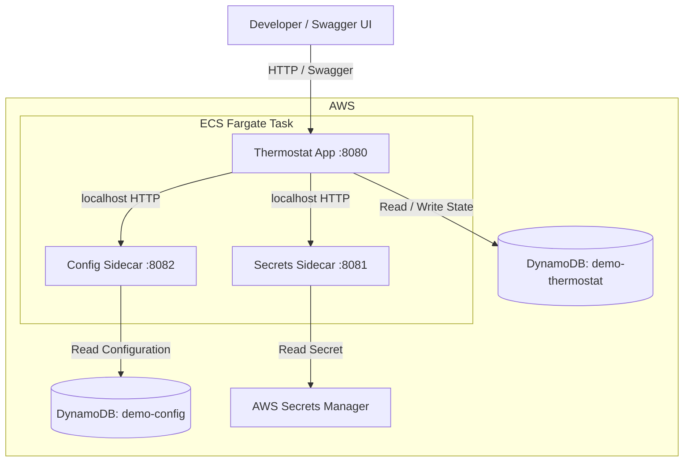

# Thermostat Platform Demo — Technical Specification

Version 1.0 · Implementation language: Go · AWS ECS / DynamoDB · Target effort: \~8 hours per component

## 1. Overview

Build a small, containerized platform demonstration consisting of three independently developed Go services deployed
together as a single AWS ECS task.

The system demonstrates how an application consumes configuration and secrets from local platform sidecars while
maintaining its own application state.

The thermostat is simulated; no physical sensor or HVAC equipment is required.

Primary goals

- Demonstrate application-to-sidecar communication over localhost.
- Provide independently defined HTTP contracts for all three services.
- Use DynamoDB for application state and configuration storage.
- Use AWS Secrets Manager for secret storage.
- Allow interactive testing through Swagger UI.
- Keep each service independently implementable in approximately eight developer hours.

Non-goals

Production-grade security, multi-tenancy, user management, high availability, real HVAC integrations, and sophisticated
temperature simulations are outside the scope of this demonstration.

## 2. System Architecture

## System Architecture

The system consists of three Go containers deployed together in a single AWS ECS Fargate task.

All three Go containers run within one ECS Fargate task. Only the Thermostat App is externally accessible; both sidecars
communicate with the app over localhost.

## 3. Shared Contracts and Conventions

All components use Go and expose HTTP JSON APIs.

| Concern                       | Specification             |
|-------------------------------|---------------------------|
| API style                     | REST over HTTP            |
| Serialization                 | JSON                      |
| Path versioning               | `/v1`                     |
| Temperature unit              | Fahrenheit                |
| Time representation           | UTC ISO 8601              |
| Health check                  | `GET /health`             |
| Contract definition           | OpenAPI 3.x               |
| Error responses               | `error`, `message` fields |
| Logging                       | Structured JSON to stdout |
| AWS authentication            | ECS task IAM role         |
| Service-to-service networking | Localhost within ECS task |

The services must return appropriate HTTP errors for invalid input, unavailable dependencies, or missing resources. No
arbitrary retries or distributed resiliency framework is required.

## 4. Component A — Thermostat Demo App

Port 8080

\~8 hours

### Purpose

Expose a simulated thermostat that reports the current room temperature and allows a user to change its target
temperature through Swagger UI.

### Functional Requirements

1. Maintain a single logical thermostat with identifier `demo`.
2. Return the current simulated temperature and configured target temperature.
3. Allow the target temperature to be changed.
4. Keep the target temperature within configurable minimum and maximum bounds.
5. Persist thermostat state in DynamoDB.
6. Read runtime configuration from the Config sidecar.
7. Retrieve a simulator seed secret from the Secrets sidecar.
8. Publish an OpenAPI contract and host Swagger UI.

### Temperature Simulation

The thermostat does not represent a physical device.

- Default starting temperature: 72°F.
- Default target temperature: 70°F.
- The current temperature gradually approaches the target temperature.
- The rate of change is provided by the Config sidecar.
- Temperature is calculated when the thermostat is read or updated; no background simulation worker is required.
- A secret-provided simulator seed may be used to introduce small, deterministic measurement variation.
- The simulation does not model HVAC modes, seasons, or real-world physics.

The temperature calculation must be deterministic for a given saved state, timestamp, configuration, and seed. Readings
are rounded to one decimal place.

### Public API Contract

| Method | Endpoint                | Behavior                                 |
|--------|-------------------------|------------------------------------------|
| GET    | `/v1/thermostat`        | Retrieve current and target temperatures |
| PUT    | `/v1/thermostat/target` | Set target temperature                   |
| GET    | `/health`               | Report service health                    |
| GET    | `/openapi.json`         | Return the OpenAPI specification         |
| GET    | `/swagger/`             | Display interactive Swagger UI           |

Thermostat response fields

| Field                | Type      | Description                    |
|----------------------|-----------|--------------------------------|
| `id`                 | string    | Always `demo`                  |
| `currentTemperature` | number    | Current simulated temperature  |
| `targetTemperature`  | number    | Desired temperature            |
| `unit`               | string    | Always `F`                     |
| `updatedAt`          | timestamp | Latest simulation state update |

The target update request contains a numeric `targetTemperature` field. A successful update returns the new thermostat
state. Values outside the configured range return HTTP 400.

### Persistence

DynamoDB table: `demo-thermostat`

| Attribute            | Description                      |
|----------------------|----------------------------------|
| `id`                 | Partition key; `demo`            |
| `currentTemperature` | Last calculated temperature      |
| `targetTemperature`  | Current target                   |
| `updatedAt`          | Last simulation update timestamp |

The application initializes the record with default values when it does not exist. Subsequent requests use the persisted
state and elapsed time for simulation.

Concurrent updates are outside the demonstration's guarantees.

### Acceptance Criteria

- Swagger UI can retrieve the current temperature.
- Swagger UI can change the target temperature.
- Subsequent readings demonstrate movement toward the target.
- Target limits are enforced using configuration provided by the sidecar.
- Thermostat state survives a container restart.
- The app can retrieve its simulator seed through the Secrets sidecar.
- The app can run locally with equivalent local service endpoints.

## 5. Component B — Secrets Sidecar

Port 8081

\~8 hours

### Purpose

Provide a small, reusable local API for resolving application secrets without requiring the application to interact
directly with AWS Secrets Manager.

### Functional Requirements

1. Retrieve named secrets from AWS Secrets Manager.
2. Expose secrets through a local HTTP API.
3. Support one configured application namespace.
4. Return meaningful errors when secrets do not exist or AWS access fails.
5. Provide a health endpoint.
6. Never include secret values in application logs.

### API Contract

| Method | Endpoint             | Behavior               |
|--------|----------------------|------------------------|
| GET    | `/v1/secrets/{name}` | Resolve a named secret |
| GET    | `/health`            | Report sidecar health  |

Secret response fields

| Field   | Type   | Description           |
|---------|--------|-----------------------|
| `name`  | string | Logical secret name   |
| `value` | string | Resolved secret value |

The sidecar resolves an application-scoped logical name to a configured AWS Secrets Manager secret. It must not accept
arbitrary secret ARNs or unrestricted resource paths from callers.

### Demo Secret

| Property     | Value                                    |
|--------------|------------------------------------------|
| Logical name | `sensor-seed`                            |
| Storage      | AWS Secrets Manager                      |
| Purpose      | Seed for simulated temperature variation |
| Consumer     | Thermostat App                           |

The seed is demonstration data, not a credential or authentication mechanism. Its use demonstrates secret resolution and
separation from application configuration.

### Implementation Boundaries

- No secret creation, editing, or deletion API.
- No custom encryption implementation.
- No required in-memory cache.
- No automatic secret rotation or refresh loop.
- No user or tenant authorization system.
- No secret values in Swagger responses from the Thermostat API.

The sidecar uses the ECS task role to access explicitly permitted Secrets Manager resources.

### Acceptance Criteria

- A configured secret can be resolved by logical name.
- An unknown logical name returns 404.
- An AWS service failure produces a non-sensitive error response.
- Secret values are never written to logs.
- The sidecar is reachable from the application over localhost.
- The sidecar is inaccessible through the public application endpoint.

## 6. Component C — Config Source Sidecar

Port 8082

\~8 hours

### Purpose

Provide a centralized configuration-reading API backed by DynamoDB. The Thermostat App should not need to know how or
where its runtime configuration is stored.

### Functional Requirements

1. Read named configuration entries from DynamoDB.
2. Support one application namespace.
3. Return JSON-compatible configuration values.
4. Reflect changes made directly in DynamoDB on subsequent requests.
5. Report unknown configuration keys.
6. Expose a health endpoint.

### API Contract

| Method | Endpoint           | Behavior                                               |
|--------|--------------------|--------------------------------------------------------|
| GET    | `/v1/config/{key}` | Retrieve one configuration entry                       |
| GET    | `/v1/config`       | Retrieve all configuration entries for the application |
| GET    | `/health`          | Report sidecar health                                  |

Configuration response fields

| Field   | Type       | Description         |
|---------|------------|---------------------|
| `key`   | string     | Configuration name  |
| `value` | JSON value | Configuration value |

For the collection endpoint, the response contains a `config` object mapping keys to values.

### Configuration Data

DynamoDB table: `demo-config`

| Attribute     | Description                         |
|---------------|-------------------------------------|
| `application` | Partition key                       |
| `key`         | Sort key                            |
| `value`       | JSON-compatible configuration value |

The application namespace is `thermostat`.

### Required Configuration

| Key                     | Default value | Meaning                                  |
|-------------------------|---------------|------------------------------------------|
| `minTargetTemperature`  | 60            | Minimum target in °F                     |
| `maxTargetTemperature`  | 85            | Maximum target in °F                     |
| `temperatureChangeRate` | 0.5           | °F change per minute                     |
| `measurementVariation`  | 0.2           | Maximum simulated sensor variation in °F |

The Config sidecar returns stored values. The Thermostat App is responsible for interpreting and validating them.

Configuration changes become effective on the next read by the Thermostat App. The application does not maintain a
long-lived configuration cache in the initial implementation.

### Implementation Boundaries

- Read-only API.
- Configuration is seeded directly in DynamoDB.
- No configuration administration UI.
- No push notifications, polling loop, or subscriptions.
- No configuration history or rollback.
- No environment inheritance.
- No automatic schema registry.

### Acceptance Criteria

- Individual configuration entries can be retrieved.
- All thermostat configuration entries can be retrieved in one request.
- Changing a DynamoDB value affects subsequent thermostat operations without redeploying.
- Unknown keys return 404.
- DynamoDB failures return a meaningful service error.
- No public access exists to the sidecar API.

## 7. Cross-Service Behavior

### Application Startup

At startup, the Thermostat App must:

1. Resolve the required simulator seed from the Secrets sidecar.
2. Retrieve the thermostat configuration from the Config sidecar.
3. Initialize the thermostat record if it does not exist.
4. Begin serving the public API.

Missing critical configuration or an unavailable dependency prevents successful initialization. ECS should restart the
affected task if the application fails to start.

### Temperature Read

Swagger UI requests thermostat state

Thermostat App reads configuration from Config sidecar

Thermostat App reads last state from DynamoDB

Calculate current temperature using elapsed time, configuration, and seed

Persist calculated state and return JSON

### Target Temperature Update

The app reads current configuration, validates the requested temperature, calculates the current state, changes the
target, and persists the result to DynamoDB.

The updated state is returned to Swagger UI. Subsequent reads reflect the new target.

### Dependency Failure Behavior

| Failure                            | Expected behavior             |
|------------------------------------|-------------------------------|
| Secrets unavailable during startup | App fails initialization      |
| Config unavailable during startup  | App fails initialization      |
| Config unavailable during request  | HTTP 503                      |
| DynamoDB unavailable               | HTTP 503                      |
| Target temperature invalid         | HTTP 400                      |
| Config key missing                 | HTTP 404 from Config sidecar  |
| Secret name missing                | HTTP 404 from Secrets sidecar |

No distributed retry strategy or fallback state synchronization is required.

## 8. AWS Infrastructure

### Required Resources

| Resource                   | Purpose                                  |
|----------------------------|------------------------------------------|
| ECS Cluster                | Host demonstration workload              |
| ECS Fargate Service        | Run the three-container task             |
| Amazon ECR                 | Store container images                   |
| DynamoDB `demo-thermostat` | Store thermostat state                   |
| DynamoDB `demo-config`     | Store runtime configuration              |
| AWS Secrets Manager        | Store sensor seed                        |
| ECS Task Role              | AWS API permissions                      |
| ECS Execution Role         | Image pulling and logging                |
| CloudWatch Logs            | Collect container logs                   |
| Public ALB                 | Optional development-only Swagger access |

The configuration and thermostat tables use DynamoDB on-demand capacity.

### ECS Task Configuration

| Container       | Port | Essential |
|-----------------|------|-----------|
| thermostat-app  | 8080 | Yes       |
| secrets-sidecar | 8081 | Yes       |
| config-sidecar  | 8082 | Yes       |

All containers run in a single Fargate task using `awsvpc` networking and communicate using localhost.

Each container has a health endpoint. ECS dependency configuration should start the sidecars before the Thermostat App,
using health-based startup dependencies.

The initial deployment uses one task replica.

### IAM and Networking

The ECS task role must grant access to the DynamoDB tables and the demo secret. Application code must use the AWS SDK's
default credential chain rather than embedded credentials.

A key limitation is that containers within one ECS task share the task role; IAM permissions are not independently
enforced per sidecar. This is acceptable for the demo but is not a production isolation boundary.

The sidecars should listen only on `127.0.0.1`. Only port 8080 should be published through an external development
endpoint. Unauthenticated Swagger access must be restricted to a controlled demo environment.&#x20;

[image](https://www.google.com/s2/favicons?domain=https://docs.aws.amazon.com\&sz=32)

Amazon Elastic Container Service

+2

## 9. Development and Testing

Each component must be executable independently during development, with backend endpoints and resource names supplied
through environment configuration.

Required verification

- Unit tests for thermostat target validation and temperature calculation.
- Unit tests for configuration response behavior.
- Unit tests for secret resolution behavior.
- HTTP error-path tests for missing records and unavailable dependencies.
- One integrated demonstration of the three services running together.
- One ECS deployment verifying persistence and sidecar communication.

Automated integration test infrastructure is optional. A successful Swagger-driven demonstration is required.

## 10. Deliverables

Each component must provide:

- Handwritten Go implementation.
- Dockerfile.
- OpenAPI contract for its HTTP endpoints.
- README containing local execution and environment requirements.
- Basic automated tests.
- Structured application logs.
- Health endpoint.

The integrated demonstration must additionally provide a reproducible ECS task definition, AWS resource setup
instructions, seed data instructions, and a short end-to-end verification procedure.

No CI/CD pipeline, Terraform module, or deployment automation framework is required for the initial version.
Infrastructure may be provisioned manually.

## 11. Effort and Scope Constraints

ESTIMATED HANDWRITTEN IMPLEMENTATION EFFORT

| Component             | Target   | Scope constraint                                  |
|-----------------------|----------|---------------------------------------------------|
| Thermostat App        | 8 hours  | One simulated thermostat, basic Swagger UI        |
| Secrets Sidecar       | 8 hours  | Read-only, single namespace, one backend          |
| Config Source Sidecar | 8 hours  | Read-only DynamoDB access                         |
| Total                 | 24 hours | Excludes initial AWS account/network provisioning |

The estimates assume the developer has Go experience, an accessible AWS account, and working local tooling. ECS
networking, IAM setup, and first-time infrastructure provisioning can add time beyond these targets.

## 12. Definition of Done

The demonstration is complete when a developer can open Swagger UI, retrieve the current simulated temperature, change
the target temperature, and observe the reported temperature move toward the new target on subsequent requests.

In addition:

- The Secrets sidecar supplies the simulator seed.
- The Config sidecar supplies the temperature behavior and bounds.
- Changing configuration in DynamoDB influences subsequent thermostat behavior.
- Restarting the ECS task does not reset the persisted thermostat target.
- All three components run together in a single ECS Fargate task.
- Sidecar access remains local to the task.
- No service requires code generation, production-grade infrastructure, or functionality beyond the bounded contracts
  described here.

Implementation principle: These are three deliberately small, independent services. Their API contracts,
responsibilities, and boundaries should remain stable so that separate implementation tickets can subsequently be
derived without expanding the scope of the demonstration.